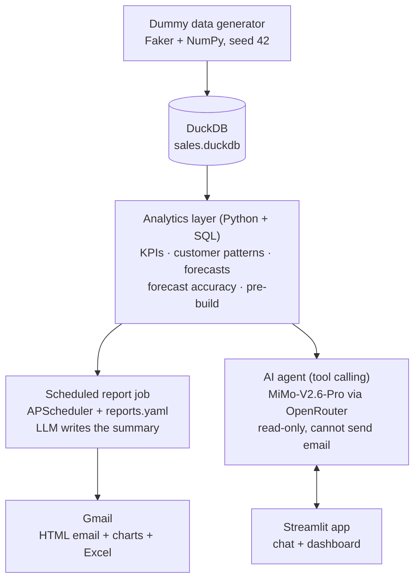

# AI Sales & Demand Analyst: Project Plan

**Repository:** `ai-sales-analyst`
**Status:** Version 1 build (6 weeks)
**Last updated:** 21 Oct 2026

---

## 1. Project overview

We are building an AI sales and demand analyst: a Python system that reads an e-commerce sales database, sends scheduled reports to Gmail with an AI-written summary, answers sales questions in plain English, and gives demand-planning feedback. Version 1 runs on generated dummy data, so no company data or IT approval is needed to build and demo it.

The project has three goals:

1. **Sales reporting:** consistent KPIs (revenue, orders, margin, top products and customers) available as reports and through a chat assistant.
2. **Automated reporting:** daily, weekly and monthly reports generated and emailed on a schedule we define, each opening with a short summary of what changed and why.
3. **Demand planning:** customer ordering-pattern alerts, forecast accuracy tracking, and pre-build recommendations that a planner reviews and approves.

**Core design rule:** every number is calculated by SQL or Python, and the AI model only explains the results. The AI never does arithmetic in its head, which keeps reports trustworthy. This matters even more with low-cost models.

---

## 2. Scope

| In scope (version 1) | Out of scope (later phases) |
| --- | --- |
| Dummy e-commerce database with 24 months of realistic data | Email inbox monitoring and attachment reports |
| Sales KPIs and daily, weekly, monthly reports | Production scheduling advice |
| Scheduled delivery to Gmail (HTML email + Excel attachment) | Connecting to real company databases (Phase 2) |
| Chat assistant for ad-hoc sales questions | Multiple clients and data sources (Phase 3) |
| Customer ordering-pattern alerts | Automatic actions (placing orders, changing stock) |
| Weekly demand forecasts and forecast accuracy | Multi-user login and permissions |
| Pre-build recommendations for a human to approve | Cloud hosting (runs on a laptop for v1) |

The database can later be swapped for a real one without rewriting reports or the agent: only the data connector and the table mapping change.

---

## 3. Final tech stack

| Layer | Choice | Why this one |
| --- | --- | --- |
| Language | Python 3.12 | One language for data, AI, reports and UI |
| Environment | `venv` + `pip`, pinned `requirements.txt` | Built into Python, nothing extra to learn |
| Editor | VS Code + Python extension, Claude Code | Free, strong Python support, built-in Git |
| Version control | Git + private GitHub repo | Backup, history, easy to share |
| Database | DuckDB (`data/sales.duckdb`) | No server, fast analytics, standard SQL so it can move to PostgreSQL later |
| Dummy data | Faker + NumPy (custom generator) | Full control over patterns and planted problems |
| Data processing | pandas | Standard for tables, works directly with DuckDB |
| Forecasting | statsforecast (AutoETS, SeasonalNaive baseline) | Fast and reliable on weekly data, installs cleanly |
| LLM access | OpenRouter (key provided by the team) | One key and one API for many models; switching models is a config change |
| AI model | Xiaomi MiMo-V2.6-Pro (`xiaomi/mimo-v2.6-pro`) | Most capable model on the low-cost shortlist (1.02T total / 42B active MoE, trained for agent tasks); tool calling, 1M context, 4 providers, $0.435 / $0.87 per 1M tokens |
| Fallback model | DeepSeek V4 Flash 0731 (`deepseek/deepseek-v4-flash-0731`) | Fast and very cheap; used automatically if the main model errors; served by about 30 providers |
| LLM client | `openai` Python SDK pointed at OpenRouter | OpenRouter is OpenAI-compatible; the same code works for any model it offers |
| Agent pattern | OpenAI-style tool calling, written directly (no framework) | Easier to understand and debug than LangChain or LangGraph at this size |
| Report templates | Jinja2 (HTML email) | Clean, readable email layouts |
| Excel attachments | openpyxl (via pandas) | Managers can filter and reuse the data |
| Email charts | matplotlib (PNG images) | Renders reliably in Gmail |
| Scheduler | APScheduler, schedules in `config/reports.yaml` | Pure Python, cross-platform, editable without code changes |
| Email delivery | Gmail SMTP with an App Password (`smtplib`) | Simplest secure Gmail option, no OAuth setup |
| User interface | Streamlit (chat + dashboard) | A working web app in pure Python |
| Interactive charts | Plotly (inside Streamlit) | Hover, zoom and filter |
| Secrets | `.env` + python-dotenv | Keys stay out of code and GitHub |
| Config | YAML (PyYAML) | Human-readable settings |
| Testing | pytest | Checks KPI math and agent answers |
| Logging | Python `logging` + audit tables in DuckDB | Every report run and tool call is traceable |

**Web framework:** none in v1 (Streamlit covers the UI). **FastAPI** is the chosen framework for the Phase 3 API. Django is only reconsidered if Phase 3 becomes a full customer portal with billing, roles and an admin panel.

`requirements.txt` packages:

```
openai
duckdb
pandas
numpy
faker
statsforecast
matplotlib
plotly
streamlit
apscheduler
jinja2
openpyxl
python-dotenv
pyyaml
pytest
```

---

## 4. What you need before starting

**Accounts and keys**

- [ ] OpenRouter API key from the team
- [ ] Confirm the key has a **$10 credit limit** and access to the main, fallback and comparison models (requested from Tech Ops)
- [ ] Dedicated Gmail account for the project (for example `yourteam.salesbot@gmail.com`)
- [ ] 2-Step Verification on that Gmail account, then an App Password (Google Account → Security → App passwords)
- [ ] GitHub account and a private repository `ai-sales-analyst`

**Software**

- [ ] Python 3.12 (on Windows, tick "Add Python to PATH")
- [ ] VS Code with the Python extension
- [ ] Git
- [ ] Claude Code
- [ ] Excel or Google Sheets to open attachments

**Hardware:** any laptop with 8 GB RAM and 2 GB free disk. The dummy database is about 100 MB.

**`.env` file** (never commit it; commit `.env.example` with empty values instead)

```
OPENROUTER_API_KEY=sk-or-...
LLM_BASE_URL=https://openrouter.ai/api/v1
LLM_MODEL=xiaomi/mimo-v2.6-pro
LLM_FALLBACK_MODEL=deepseek/deepseek-v4-flash-0731
GMAIL_ADDRESS=yourteam.salesbot@gmail.com
GMAIL_APP_PASSWORD=abcd efgh ijkl mnop
REPORT_MODE=dry_run
TIMEZONE=Europe/London
```

Set `TIMEZONE` to your own IANA time zone. `LLM_MODEL` and `LLM_FALLBACK_MODEL` can be changed to any OpenRouter model slug without touching code. `REPORT_MODE=dry_run` saves reports to `outputs/reports/` instead of emailing them; switch to `send` once reports look right.

**Approval:** the project uses dummy data only, so no company data leaves the building. Moving to real data (Phase 2) needs IT sign-off on sending query results through OpenRouter to the model provider.

---

## 5. Dummy data design

`src/data/generate.py` (run with `python -m src.data.generate`) builds a fake online store with 24 months of history, **1 Oct 2024 to 30 Sep 2026**, using random seed **42** so every run produces identical data.

### Tables

| Table | Key columns | Rows (approx.) |
| --- | --- | --- |
| `customers` | customer_id, name, email, customer_type (retail / wholesale), country, region, signup_date | 2,000 (150 wholesale) |
| `products` | product_id, sku, name, category, unit_price, unit_cost, launch_date, lead_time_days | 250 in 8 categories |
| `orders` | order_id, customer_id, order_date, channel (web / mobile / marketplace), status (completed / cancelled / returned), discount_code | 70,000 |
| `order_items` | order_item_id, order_id, product_id, quantity, unit_price, discount_pct | 180,000 |
| `inventory` | product_id, snapshot_date (weekly), on_hand, on_order | 26,000 |
| `forecasts` | product_id, week_start, forecast_qty, model, created_at | 8 seeded weeks, then grows weekly |

Categories: Electronics, Home & Kitchen, Apparel, Beauty, Sports & Outdoors, Toys, Office, Pet Supplies.

### Realistic patterns

- November and December run about 40% above average; January dips.
- Retail orders peak on weekends; wholesale orders arrive on weekdays.
- Overall revenue grows about 15% per year.
- Wholesale customers reorder on their own 2 to 6 week cycle with larger baskets.
- Four promotions per year with discount codes and a sales spike.
- About 3% of orders cancelled and 5% returned.
- Some products launch mid-period; a few are discontinued.
- Seeded forecasts (Aug to Sep 2026) have realistic error so accuracy can be tested from day one.

### Planted problems (the AI must find these)

| # | Problem | Detail |
| --- | --- | --- |
| 1 | Wholesale churn | "Harbor & Pine Co.", "Bluegate Supplies" and "Kestrel Home Stores" mainly buy Apparel and stop ordering after mid-August 2026 |
| 2 | Category decline | Apparel net revenue falls about 30% from July to September 2026 |
| 3 | Stockouts | 10 products have `on_hand = 0` (sales capped) for 1 to 3 weeks in September 2026 |
| 4 | Forecast bias | "Classic Denim Jacket" (AP-1150): seeded forecasts run about 25% too high |
| 5 | Pre-build need | "Smart Bottle Pro" (SB-1042): launched July 2026, demand up about 60% in the last 4 weeks, stock covers about 9 days |

A description of each is saved to `data/planted_issues.json` and used by the tests.

---

## 6. System architecture

Data flows one way: generator → database → analytics layer, then out to two consumers: the scheduled report job (to Gmail) and the chat agent (to Streamlit). Both call the same analytics functions, so a number in an email always matches the same number in chat.



---

## 7. Module 1: Sales reporting

All KPI definitions live as SQL views in `src/analytics/kpis.sql`, so every report, dashboard and chat answer uses the same numbers.

### KPI definitions

| KPI | Definition |
| --- | --- |
| Net revenue | Sum of quantity × unit_price × (1 − discount_pct) for completed orders, minus returned orders |
| Orders | Count of completed orders |
| Average order value (AOV) | Net revenue ÷ orders |
| Units sold | Sum of quantity on completed orders |
| Gross margin % | (Net revenue − cost of goods) ÷ net revenue |
| New vs returning customers | First-ever order in the period vs a customer who ordered before |
| Cancellation rate | Cancelled orders ÷ all orders |
| Return rate | Returned orders ÷ completed orders |
| Top products / customers | Top 10 by net revenue, with change vs previous period |
| Breakdowns | Net revenue by category, region, channel and customer type |

### Standard reports

| Report | Contents | Comparison |
| --- | --- | --- |
| Daily sales snapshot | Yesterday's revenue, orders, AOV, top 5 products, cancellations | vs same weekday last week |
| Weekly sales review | All KPIs, category and channel breakdown, top 10 products and customers, demand alerts | vs previous week and same week last year |
| Monthly business review | All KPIs with trend charts, margin by category, customer growth, forecast accuracy | vs previous month and same month last year |

### Ad-hoc questions

Through the Streamlit chat, users ask questions such as "Which category grew fastest last quarter?". The agent writes a read-only SQL query, runs it, and answers with the table, a chart, and the query it used.

---

## 8. Module 2: Scheduled reports to Gmail

| Report | Schedule | Format |
| --- | --- | --- |
| Daily sales snapshot | Monday to Friday, 07:00 | HTML email |
| Weekly sales review + demand alerts | Monday, 08:00 | HTML email + Excel attachment |
| Monthly business review + forecast accuracy | 1st of the month, 08:00 | HTML email + Excel attachment |

Times use `TIMEZONE` from `.env`.

### How one report run works

1. APScheduler triggers the job at the scheduled time.
2. The report's SQL queries run against DuckDB (read-only).
3. pandas compares this period with the comparison period and computes changes.
4. matplotlib draws 2 to 4 charts as PNG images.
5. The computed numbers (as JSON) go to the LLM, which writes a 3 to 5 sentence summary: what changed, the likely reason, and what to check. The model receives only these numbers, never database access.
6. Jinja2 renders the HTML email: summary, KPI table, charts, top-10 tables.
7. pandas writes detail tables to an Excel file.
8. `send` mode emails it through `send_report()`; `dry_run` mode saves HTML and Excel to `outputs/reports/`.
9. The run, recipients, status and any error are written to the `report_runs` table.

### Config example (`config/reports.yaml`)

```yaml
weekly_sales_review:
  schedule: { day_of_week: mon, hour: 8, minute: 0 }
  queries: [kpis_week, category_breakdown, top_products, top_customers, demand_alerts]
  compare_to: [previous_week, same_week_last_year]
  charts: [revenue_trend_13w, revenue_by_category]
  attach_excel: true
  recipients: [you@example.com]
```

Adding a report means adding a block here, not writing new code. During the build, recipients list only you; add your team lead after two weeks of checked dry-run reports.

### Failure handling

If a run fails, the system retries once after 5 minutes, then emails you a short failure notice. If the main model fails, the fallback model is tried; if both are unavailable, the report still sends with the numbers and without the summary.

---

## 9. Module 3: Demand planning

Runs every Monday before the weekly report. Results go into the weekly and monthly emails and the dashboard.

### 9.1 Customer ordering patterns

For each customer with at least 4 orders: usual days between orders, days since last order, average basket value, and trend in order value (last 90 days vs prior 90 days). Customers are also grouped into RFM segments (recency, frequency, monetary value): Champions, Loyal, At risk, Lost, New.

| Alert | Rule |
| --- | --- |
| Overdue customer | Days since last order > 1.5 × usual interval (> 2 × = serious) |
| Declining customer | Order value in last 90 days down more than 25% vs prior 90 days |
| New high-value customer | First order in last 60 days and total spend in the top 10% |
| Segment movement | Moved from Champions or Loyal into At risk |

### 9.2 Forecast and forecast accuracy

- Weekly demand per product, 12-week horizon, statsforecast.
- AutoETS is the main model; SeasonalNaive (same week last year) is the baseline the main model must beat.
- Stockout weeks are excluded from training so lost sales don't drag forecasts down.
- Every forecast is saved to `forecasts`, so accuracy is measured against what actually sold.

$$
\text{WAPE} = \frac{\sum |\text{actual} - \text{forecast}|}{\sum \text{actual}}
\qquad
\text{Bias} = \frac{\sum (\text{forecast} - \text{actual})}{\sum \text{actual}}
$$

WAPE shows how far off the forecast is; bias shows whether it is consistently too high (positive) or too low (negative). A product is flagged when **WAPE > 40%** or **bias beyond ±15%** over the last 8 weeks. A 26-week backtest gives a starting accuracy figure.

### 9.3 Pre-build recommendations

$$
\text{Build qty} = \max\left(0,\ \text{forecast over lead time} + \text{safety stock} - \text{on hand} - \text{on order}\right)
$$

$$
\text{Safety stock} = 1.65 \times \sigma_{\text{weekly demand}} \times \sqrt{\text{lead time in weeks}}
$$

The factor 1.65 targets a 95% chance of not running out during the lead time. Each recommendation lists product, quantity, weeks of stock left, and a one-line reason written by the LLM. Products with a forecast bias alert are excluded and explained. **Recommendations are suggestions only; a planner approves them, and the system never places orders.**

---

## 10. AI agent design

The agent is Xiaomi MiMo-V2.6-Pro, called through OpenRouter, with seven tools, each a plain Python function. The model chooses tools and explains results; tools do all calculation and data access.

| Tool | What it does | Limits |
| --- | --- | --- |
| `run_sql` | Runs a SELECT on DuckDB, returns rows | Read-only, single SELECT only, max 500 rows, 10-second timeout |
| `get_kpis` | Standard KPIs for a period and comparison | Uses the shared KPI views |
| `get_customer_alerts` | Overdue, declining, new high-value customers | Filters by type, region, segment |
| `get_forecast` | 12-week forecast for a product or category | Reads `forecasts` |
| `get_forecast_accuracy` | WAPE and bias by product or category | Last 8 weeks by default |
| `get_prebuild_recommendations` | Current recommendation list | Read-only, cannot approve |
| `make_chart` | Plotly chart from a result table | Streamlit only |

The chat agent has **no tool for sending email or changing data**. Only the scheduled report job sends email.

### LLM client (`src/agent/llm.py`)

All model calls go through one small module. OpenRouter is OpenAI-compatible, so it uses the `openai` SDK with a different base URL:

```python
import os
from openai import OpenAI

client = OpenAI(base_url=os.environ["LLM_BASE_URL"], api_key=os.environ["OPENROUTER_API_KEY"])

def chat(messages, tools=None):
    for model in (os.environ["LLM_MODEL"], os.environ["LLM_FALLBACK_MODEL"]):
        try:
            return client.chat.completions.create(
                model=model, messages=messages, tools=tools, temperature=0
            )
        except Exception as err:          # log and try the fallback
            last_error = err
    raise last_error
```

### Working well with low-cost models

The design leans on structure rather than model strength, so it keeps working if the fallback model takes over or the team switches to a cheaper model:

- **Fixed tools first.** The prompt tells the model to use the six fixed tools whenever they fit and `run_sql` only when they don't, which cuts SQL mistakes.
- **Temperature 0** for repeatable answers and summaries.
- **Validated tool calls.** Tool arguments are checked against each tool's JSON schema; an invalid call returns a clear error to the model, with up to 2 retries.
- **Short, concrete prompts.** Compact schema description plus 5 example question-to-SQL pairs.
- **Fast routing.** MiMo-V2.6-Pro is served by several providers; use OpenRouter's Nitro routing (fastest provider) to cut response time. Check the exact setting in OpenRouter's provider-routing docs.
- **Measured, not assumed.** The 20-question evaluation (target 19 of 20) and the Week 4 model comparison decide which model is used. Switching is a `.env` change, not a code change.

### Model comparison (Week 4)

`scripts/compare_models.py` runs the same tests through each candidate model and writes a results table to `outputs/model_comparison.md`. It takes about an hour and costs cents.

| Candidate | OpenRouter ID | Role |
| --- | --- | --- |
| MiMo-V2.6-Pro | `xiaomi/mimo-v2.6-pro` | Current main model |
| DeepSeek V4 Flash 0731 | `deepseek/deepseek-v4-flash-0731` | Current fallback |
| MiMo-V2.6-Flash | `xiaomi/mimo-v2.6-flash` | Cheaper Xiaomi option |
| DeepSeek V4.1 Flash | `deepseek/deepseek-v4.1-flash` | Team's original suggestion |
| Claude Haiku 5.5 | `anthropic/claude-haiku-5.5` | Fast small-model contender |

Each model is scored on:

- Correct answers on the 20 test questions (checked against known SQL results)
- Valid tool calls (right tool, valid arguments, no retries needed)
- Summary accuracy: every number in a weekly report summary must appear in the input data
- Median response time per question
- Cost per question

The best accuracy wins; speed breaks ties. The most reliable multi-provider runner-up becomes the fallback. Results and the final choice go into the decisions log.

### System prompt rules (`src/agent/prompts.py`)

- Every number must come from a tool result in this conversation; never estimate or calculate in your head.
- Show the SQL used for any `run_sql` answer.
- If the data can't answer the question, say so and what data would be needed.
- State the date range and filters behind every figure.
- Answer first, then up to 3 supporting points.

The prompt also contains the database schema, KPI definitions and 5 example question-to-SQL pairs, so the model writes correct SQL first time.

### Agent loop

Send the question → run any tools the model requests → return results → repeat until a final answer, **max 10 tool calls**. History is kept in the Streamlit session. Each tool call (name, inputs, row count, duration) is logged to `agent_log`.

---

## 11. Project folder structure

```
ai-sales-analyst/
├── .env                      # secrets (never committed)
├── .env.example              # empty template (committed)
├── .gitignore                # .env, .venv/, data/*.duckdb, outputs/
├── requirements.txt
├── README.md                 # setup and run instructions
├── CLAUDE.md                 # context and rules for Claude Code
├── config/
│   └── reports.yaml          # schedules, recipients, report contents
├── data/
│   ├── sales.duckdb          # generated database
│   └── planted_issues.json   # what the AI should find (for tests)
├── docs/
│   └── project_plan.md       # this file
├── src/
│   ├── data/
│   │   └── generate.py       # dummy data generator ("connector #1")
│   ├── analytics/
│   │   ├── kpis.sql          # KPI view definitions
│   │   ├── kpis.py           # KPI queries and period comparisons
│   │   ├── customers.py      # ordering patterns, RFM, alerts
│   │   ├── forecasting.py    # models, backtest, accuracy
│   │   └── prebuild.py       # safety stock and build quantities
│   ├── agent/
│   │   ├── llm.py            # OpenRouter client, model + fallback
│   │   ├── tools.py          # the 7 tools + schemas
│   │   ├── prompts.py        # system prompt, schema description
│   │   └── agent.py          # tool-use loop
│   ├── reports/
│   │   ├── builder.py        # queries, charts, LLM summary
│   │   ├── emailer.py        # send_report() with Gmail SMTP
│   │   ├── scheduler.py      # APScheduler jobs from reports.yaml
│   │   └── templates/
│   │       └── report.html   # Jinja2 email template
│   └── app/
│       └── streamlit_app.py  # chat + dashboard
├── outputs/
│   ├── reports/              # dry-run reports and Excel files
│   └── logs/
├── scripts/
│   └── compare_models.py     # Week 4 model comparison
└── tests/
    ├── test_data.py
    ├── test_kpis.py
    ├── test_forecasting.py
    ├── test_sql_guard.py
    └── test_agent_questions.py
```

**Run commands**

```
python -m src.data.generate              # build the database
python -m src.reports.scheduler          # start scheduled reports
streamlit run src/app/streamlit_app.py   # open chat and dashboard
pytest                                   # run all tests
```

---

## 12. Build plan

Plan about 8 to 10 hours a week. If a week slips, cut dashboard polish in Week 6, never the tests.

| Week | Focus | Deliverables | Done when |
| --- | --- | --- | --- |
| 1 | Setup and dummy data | Tools and accounts, repo scaffold, CLAUDE.md, data generator, `test_data.py` | All 6 tables load and the 5 planted problems are present |
| 2 | Sales KPIs and report builder | KPI SQL views, period comparisons, Jinja2 template, matplotlib charts, Excel export | KPI tests pass and the weekly report matches hand-checked numbers |
| 3 | Scheduling and Gmail | APScheduler + `reports.yaml`, `send_report()` via Gmail SMTP, retry and failure email, dry-run mode | All 3 reports arrive in your inbox on schedule |
| 4 | AI summaries, chat agent, model comparison | `llm.py` client, LLM-written summaries, 7 tools, SQL guard, tool-calling loop, `agent_log`, `compare_models.py` | 19 of 20 test questions answered correctly; model choice confirmed with scores |
| 5 | Demand planning | Customer alerts and RFM, forecasts and backtest, WAPE and bias, pre-build list | Monday report flags all 5 planted problems |
| 6 | Dashboard, hardening, demo | Streamlit dashboard and chat, README, guardrail tests, reviewed dry-run reports | Live demo to the team lead |
| Gate | Phase 2 go / no-go | Team lead approval; IT sign-off for real data | Decision recorded |

---

## 13. Guardrails, security and testing

The system can read data and send reports, but it can never change data, place orders, or email anyone outside the approved list.

| Risk | Guardrail |
| --- | --- |
| AI changes or deletes data | DuckDB opened with `read_only=True` for agent and reports; SQL guard rejects anything that is not a single SELECT |
| AI invents numbers | System prompt rule + tests comparing agent answers with known SQL results |
| Huge or slow queries | 500-row limit, 10-second timeout |
| Report sent to wrong people | Recipient allowlist in `reports.yaml`; `dry_run` during the build |
| Leaked keys | Keys only in `.env` (git-ignored); Gmail App Password can be revoked any time |
| Unexpected API costs | $10 credit limit on the OpenRouter key; max 10 tool calls per question; token usage and cost logged per call |
| Model makes mistakes | Fixed tools preferred over free SQL, temperature 0, tool arguments validated, 20-question evaluation before the demo |
| Model or provider outage | Automatic retry on `LLM_FALLBACK_MODEL`; reports still send without the summary |
| Silent failures | Every run and tool call logged; failure email if a report can't send |
| Wrong recommendation acted on | Pre-build list is suggestions only; a planner approves |

**Tests**

- **KPI tests:** a 20-order mini dataset with hand-calculated answers; every KPI must match exactly.
- **Forecast tests:** WAPE, bias and build-quantity formulas checked against worked examples.
- **SQL guard tests:** INSERT, UPDATE, DELETE, DROP and multi-statement queries are rejected.
- **Agent evaluation:** 20 questions with known answers; target 19 of 20.
- **Planted-problem check:** the weekly report flags all 5 planted problems.
- **Report review:** two weeks of dry-run reports checked by hand before anyone else receives them.

---

## 14. Design rules for future growth

Three rules in v1 cost almost nothing and make later changes a plug-in job rather than a rewrite:

1. **Standard data model.** Analytics, reports and the agent only read the six standard tables. The dummy generator is "connector #1": it outputs those tables. Real sources later get their own connector that writes the same tables.
2. **One email function.** All sending goes through `send_report(report, recipients)` in `src/reports/emailer.py`, with Gmail SMTP as the first implementation. Other providers are added behind the same function.
3. **One LLM client.** Every model call goes through `src/agent/llm.py`. Model names come from `.env`, so moving to a stronger model (or to a different provider) later changes one file and two settings, not the agent or reports.

---

## 15. Roadmap after v1

### Phase 2: real company data

- IT approval for sending query results through OpenRouter, including which providers may serve requests and their data-retention terms (OpenRouter lets you restrict providers).
- A connector for the company's e-commerce database writing the standard tables.
- Run on a company server or VM instead of a laptop.

### Phase 3: multiple clients and data sources

Each client's data is copied into its own DuckDB in the standard model; the agent always queries that copy with SQL, so SQL and NoSQL sources are handled the same way.

| Client source | How data is pulled | Watch for |
| --- | --- | --- |
| Shopify | Shopify Admin API | Closest fit to the standard tables |
| Salesforce | REST or Bulk API | Sales may live in Opportunities, Orders or custom objects |
| SQL databases (PostgreSQL, MySQL, SQL Server) | Read-only SQLAlchemy connection + mapping file | Table and column names differ per client |
| NoSQL (MongoDB etc.) | Read and flatten documents | Nested order items must be split into `order_items` |
| CSV / spreadsheet exports | Upload or shared folder | Fallback for small clients |

The `dlt` Python library is the candidate for ready-made Shopify, Salesforce, SQL and MongoDB sources. Each client gets a mapping config (their columns → standard columns).

Phase 3 also adds:

- **Email:** sending from our domain via a transactional service (SendGrid, Amazon SES or Postmark), or from the client's Microsoft 365 / Google Workspace via OAuth.
- **API:** FastAPI wrapping the existing analytics, agent and report modules.
- **Isolation:** separate database, config and secrets per client.
- **Access:** login for the web app.
- **Hosting:** cloud server.
- **Agreements:** each client approves their data being processed by the chosen model provider.

---

## 16. Decisions log

All v1 decisions are final; revisit only at the Phase 2 gate.

| Decision | Choice |
| --- | --- |
| Report delivery | Gmail (dedicated account, SMTP + App Password) |
| LLM access | OpenRouter, key provided by the team |
| Model | `xiaomi/mimo-v2.6-pro`; fallback `deepseek/deepseek-v4-flash-0731`; both set in `.env`; confirmed by the Week 4 comparison |
| AI budget | $10 credit limit on the OpenRouter key for the POC |
| LLM client | `openai` Python SDK with OpenRouter base URL |
| Python approach | Plain Python, no agent framework |
| Web framework | None in v1 (Streamlit); FastAPI in Phase 3 |
| Data source | Generated dummy data, 24 months, seed 42 |
| Database | DuckDB, standard SQL |
| Forecasting | statsforecast AutoETS, SeasonalNaive baseline, weekly, 12-week horizon |
| Accuracy measures | WAPE and bias over 8 weeks; flags at 40% WAPE or ±15% bias |
| Safety stock | 95% service level (factor 1.65) |
| Report set | Daily snapshot, weekly review, monthly review |
| Report format | HTML email with charts; Excel for weekly and monthly |
| Scheduler | APScheduler on a laptop; schedules in YAML |
| User interface | Streamlit chat + dashboard |
| Hosting | Laptop for v1; server after the Phase 2 gate |
| Agent permissions | Read-only; cannot send email or change data |
| Build length | 6 weeks to demo |